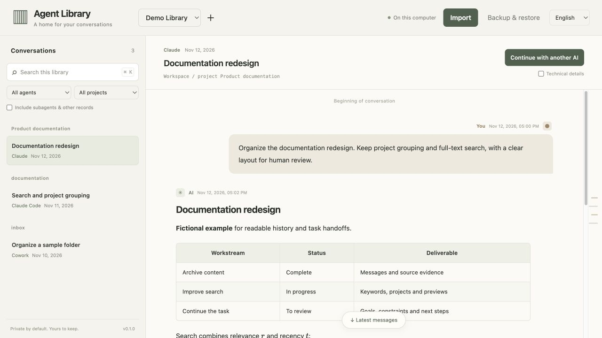
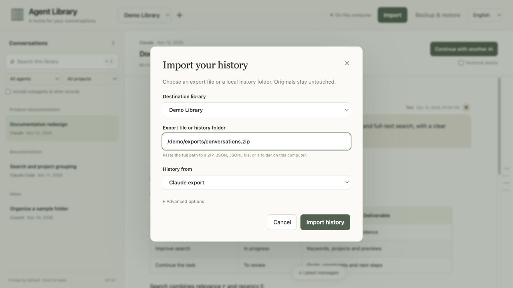
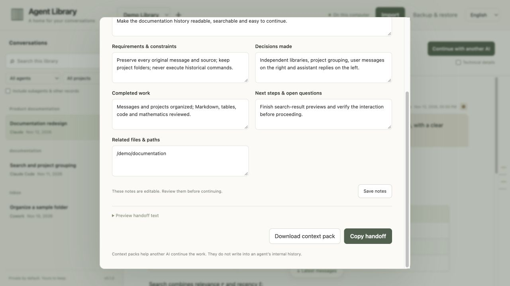

# Agent Library

[简体中文](README.md) · English

**A home for your agent histories. A starting point for what comes next.**

Agent Library is a local-first conversation library. Keep histories from different tools in independent
collections, organize them by project and time, search the original text, and hand a selected conversation
to another AI to continue the work.



Every screenshot uses fictional demonstration data, with no real conversations, private files or personal configuration.

**v0.1 public preview.** Daily use requires no account, API key or external LLM.
This is an independent project, not affiliated with or endorsed by Anthropic or OpenAI.
Product names describe compatible sources and handoff destinations only.

## Quick start

Requires Python 3.11+ with SQLite. macOS, Windows and Linux are the target platforms; see the
[local verification record](docs/QA_RELEASE.md) for actual coverage. Node.js is only for development.

[Download the source ZIP](https://github.com/jovequli/agent-library/archive/refs/heads/main.zip),
extract it, then run these commands from the project directory:

```sh
python3 -m venv .venv
# On Windows, use py -3 -m venv .venv.
# After activating .venv:
python -m pip install -e .
agent-library serve --open
```

Open the printed local address. Source checkouts also include
[`scripts/start.command`](scripts/start.command) for macOS and
[`scripts/start.bat`](scripts/start.bat) for Windows; Python 3.11+ is still required.

User data defaults to `~/.agent-library`, outside the source project. Choose another location with:

```sh
agent-library --home /path/to/my-agent-library serve --open
```

## Three steps to continue the work

### 1. Bring in your history

Choose **Import**, select or create a library, and paste the full local path to an export file or history folder.
Use **Explore a demo** to try fictional examples first. Import preserves a managed source copy, so reading
does not depend on the original folder staying in place.



### 2. Find and read the conversation

Filter by agent, project or keyword. Ordinary conversations group by time; Code and Cowork retain their task paths.
Open at the latest message at the bottom and scroll upward for earlier turns. Preview a message before explicitly
choosing to jump to it.

Read headings, tables, code, inline and display mathematics. Your messages align right and AI replies left.
Tools, thinking and system records are optional. Preserved images are viewable, task attachments remain separate,
and missing content stays clearly marked.

### 3. Continue with another AI

Choose **Continue with another AI**, review the goal, constraints, decisions, completed work and next steps,
then copy the handoff prompt or download a context pack. It contains the full transcript, all user requirements,
source references and preserved images. Context packs can also be imported back into Agent Library.



A context pack is portable background material. It does not write into another app's internal chat database
or inherit historical permissions, processes or tool connections. Check that the contents may be disclosed
before submitting them to another LLM.

## Supported sources

| Source | Input | Preserved information |
| --- | --- | --- |
| Claude | Export ZIP, extracted folder or conversations JSON | Messages, timestamps, available project labels and preserved attachment content |
| Claude Code | `.claude`/projects folder or session JSONL | Workspace paths, tools/thinking, subagent relationships and explicitly labeled input-only history |
| Cowork | Local session folder or enclosing backup | Task/workspace metadata, transcript/audit records, selected folders and available images |

The framework is provider-neutral. These are the first raw-format adapters; ChatGPT, Codex and other raw exports
need separate adapters. A source label alone does not convert a format. Historical commands are data and are never executed.

An existing normalized record library can be migrated into a new independent library without changing its originals.
This preserves source order, historical identifiers, classification, image associations and the previous transcript,
requirements and handoff documents:

```sh
agent-library migrate-legacy /path/to/export/record_library --source-root /path/to/export --name "Imported history"
```

The explicit source root contains the old library and its `extracted` and `local_backup` folders.
Migration needs space for a complete independent copy. Imports are additive: the same `--dataset LABEL`
updates matching provider/native conversation IDs and appends new conversations. An unchanged source is a no-op;
conversations absent from later inputs remain preserved. Use distinct dataset labels to isolate independent sources.

## Backup and restore

Open **Backup & restore** to create a verified private ZIP or restore one into a new independent library.
Backups include the database, managed source snapshots, images, import reports and edited handoff notes.
The original source folder is not needed on the receiving computer. Restore verifies the file manifest,
SHA-256, ZIP, paths and database consistency without overwriting an existing library.

```sh
agent-library create "Research shelf"
agent-library import LIBRARY_ID /path/to/export.zip --provider claude
agent-library search LIBRARY_ID "research question"
agent-library handoff LIBRARY_ID SESSION_ID --target codex --output /path/to/context.zip
agent-library backup LIBRARY_ID /path/to/library-backup.zip
agent-library verify-backup /path/to/library-backup.zip
agent-library restore /path/to/library-backup.zip --name "Restored shelf"
agent-library doctor
```

Backups and context packs contain unencrypted private material. Store them separately; they are not source releases.

## Development and licensing

The Python runtime uses the standard library. Web components and fonts are bundled. SQLite FTS5 trigram speeds up
search where available; short queries and other builds use a compatible fallback. No CDN, cloud database, telemetry
or automatic LLM request is needed.

```sh
python -m unittest discover -s tests -v
python scripts/verify_vendor.py
python scripts/check_release.py
npm ci
npm test
```

The project's own source is MIT-licensed; third-party components retain their licenses. The source license does not
license imported content. See [contributing](CONTRIBUTING.md), [privacy and security](SECURITY.md),
[third-party notices](THIRD_PARTY_NOTICES.md) and the short [project notes](docs/PROJECT_BOUNDARIES.md).
Examples and tests must remain fictional. Automated release checks supplement human review.
