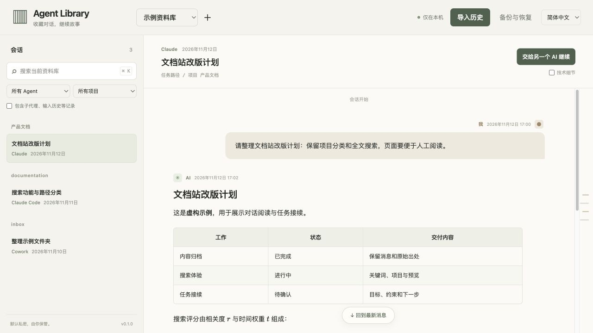
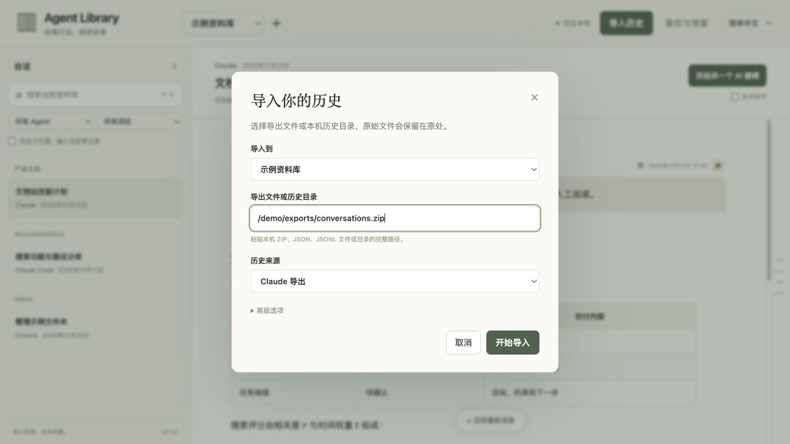
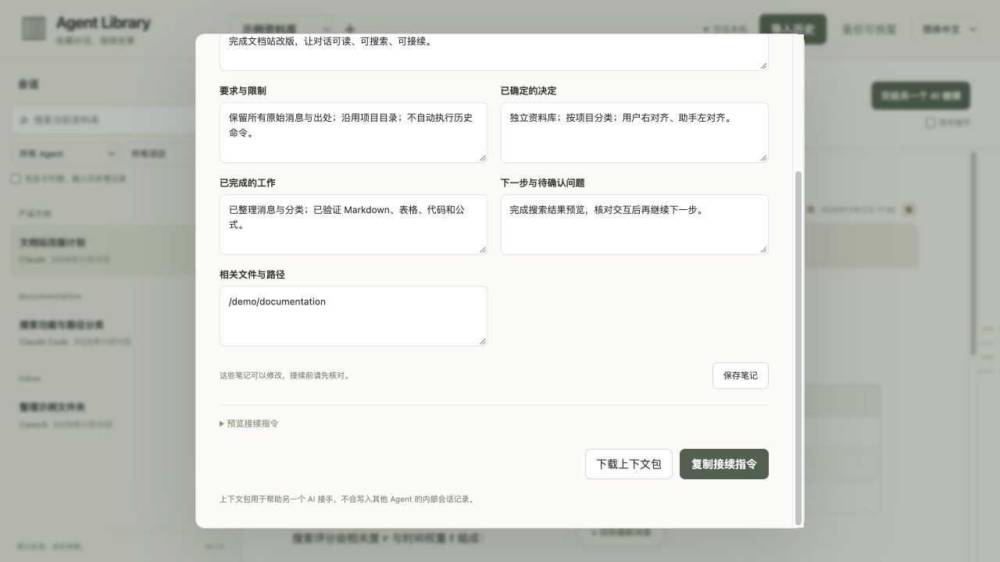

# Agent Library

简体中文 · [English](README.en.md)

**不同 Agent 的历史，一处收藏、阅读和接续。**

Agent Library 是一个本地优先的对话图书馆：把不同工具的历史放入独立资料库，
按项目和时间整理，搜索原文，再将选定对话交给另一个 AI 继续。



截图全部来自虚构演示资料，未使用真实聊天、私人文件或个人配置。

当前为 **v0.1 公开预览版**。日常使用不需要账号、API 密钥或外部 LLM。
本项目独立开发，与 Anthropic、OpenAI 无官方关联或背书；产品名称仅说明兼容来源和接续目标。

## 快速开始

需要 Python 3.11 或更新版本及其 SQLite。目标平台为 macOS、Windows 和 Linux；
实际验证范围见[本地验证记录](docs/QA_RELEASE.md)。日常使用不需要 Node.js。

先[下载源码 ZIP](https://github.com/jovequli/agent-library/archive/refs/heads/main.zip)，
解压后在项目目录中运行：

```sh
python3 -m venv .venv
# Windows 改用 py -3 -m venv .venv。
# 激活 .venv 后：
python -m pip install -e .
agent-library serve --open
```

打开终端显示的本机地址即可使用。macOS 也可打开
[`scripts/start.command`](scripts/start.command)，Windows 可打开
[`scripts/start.bat`](scripts/start.bat)，仍需先有 Python 3.11 或更新版本。

默认资料目录为 `~/.agent-library`，与源码分开。可以指定其他位置：

```sh
agent-library --home /path/to/my-agent-library serve --open
```

## 三步开始

### 1. 接入历史

点击 **导入历史**，选择或新建资料库，填写本机导出文件或历史目录的完整路径。
也可以先点 **体验示例资料库**。导入保留来源副本，正常阅读不依赖原目录的位置。



### 2. 找到并读懂对话

按 Agent、项目或关键词筛选。普通会话按时间归类，Code 和 Cowork 保留任务路径。
打开后从底部最新消息开始，向上翻阅历史；先预览消息，明确点击后再定位。

标题、表格、代码、行内和独立公式正常排版。用户消息在右侧，AI 回复在左侧；
工具、思考和系统记录可选展开。已保留的图片可以查看，任务附件独立展示，缺失内容如实标记。

### 3. 换一个 AI，接着做

点击 **交给另一个 AI 继续**，核对目标、约束、决定、已完成事项和待办，
然后复制接续提示词，或下载含完整原文、全部用户要求、出处和图片的上下文包。
上下文包也可以重新导入 Agent Library。



接续包提供可携带的背景资料，不会写入其他应用的内部聊天数据库，
也不会继承历史权限、运行进程或工具连接。向另一家 LLM 提交前，请确认内容可以披露。

## 支持的来源

| 来源 | 输入 | 主要保留信息 |
| --- | --- | --- |
| Claude | 导出 ZIP、解压目录或 conversations JSON | 正文、时间、可用项目分类及已保留的附件内容 |
| Claude Code | `.claude`／projects 目录或会话 JSONL | 工作目录、工具与思考记录、子代理关系、明确标注的仅输入历史 |
| Cowork | 本机会话目录或其上层备份 | 任务与工作目录、正文／审计记录、选定目录和可用图片 |

框架面向多种 Agent。目前这三类是首批原始格式适配器，ChatGPT、Codex 等原始格式
需后续分别适配；来源标签本身不会转换格式。历史命令只作为资料保存，不会自动执行。

已有的规范化记录库可完整迁入新的独立资料库，保留顺序、历史编号、分类、图片对应关系
及原整理的全文、用户要求和接续说明，原库不变：

```sh
agent-library migrate-legacy /path/to/export/record_library --source-root /path/to/export --name "导入的历史"
```

来源根目录应包含旧库及其 `extracted`、`local_backup` 文件夹。迁移需要独立完整副本的空间。
导入采用累加方式：相同 `--dataset LABEL` 下更新匹配的来源与原生会话 ID，追加新会话；
重复来源不会重复导入，后续来源未包含的旧会话仍保留。独立来源可用不同 dataset 标签隔离。

## 备份与恢复

打开 **备份与恢复** 生成经过校验的私有 ZIP，或将备份恢复为新的独立资料库。
备份包含数据库、来源快照、图片、导入报告和人工编辑的接续说明，换电脑无需原目录。
恢复会验证文件清单、SHA-256、ZIP、路径及数据库一致性，不覆盖现有库。

```sh
agent-library create "研究资料库"
agent-library import LIBRARY_ID /path/to/export.zip --provider claude
agent-library search LIBRARY_ID "研究问题"
agent-library handoff LIBRARY_ID SESSION_ID --target codex --lang zh-CN --output /path/to/context.zip
agent-library backup LIBRARY_ID /path/to/library-backup.zip
agent-library verify-backup /path/to/library-backup.zip
agent-library restore /path/to/library-backup.zip --name "恢复的资料库"
agent-library doctor
```

备份和接续包包含未加密的私人资料，应单独妥善存放，不随源码发布。

## 开发与许可

Python 运行部分使用标准库，网页组件与字体随项目提供。搜索在支持时使用 SQLite FTS5
trigram，较短关键词或其他环境使用兼容检索；不需要 CDN、云数据库、遥测或自动调用 LLM。

```sh
python -m unittest discover -s tests -v
python scripts/verify_vendor.py
python scripts/check_release.py
npm ci
npm test
```

项目自身代码采用 MIT，第三方组件保留各自许可；源码许可不授予导入内容的权利。
详见 [贡献说明](CONTRIBUTING.md)、[隐私与安全](SECURITY.md)、
[第三方许可](THIRD_PARTY_NOTICES.md)和[简要项目说明](docs/PROJECT_BOUNDARIES.md)。
示例与测试必须保持虚构，自动发行检查只能辅助人工审阅。
